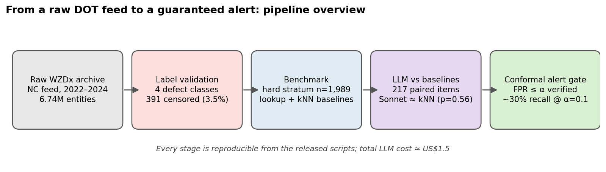
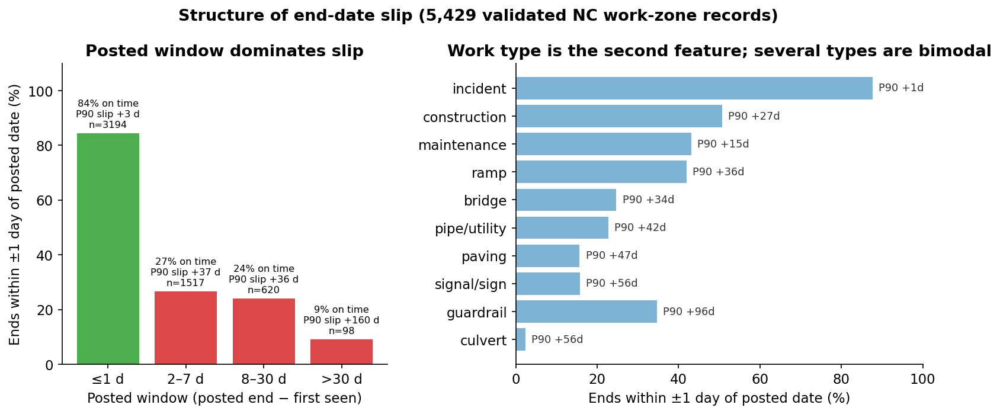
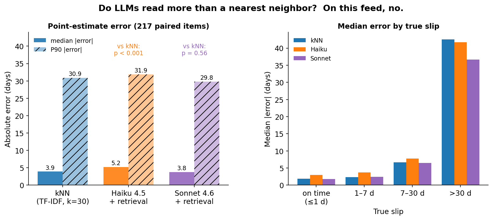
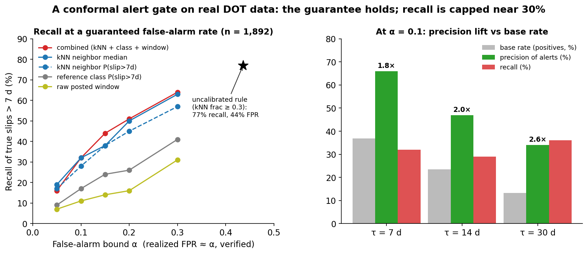
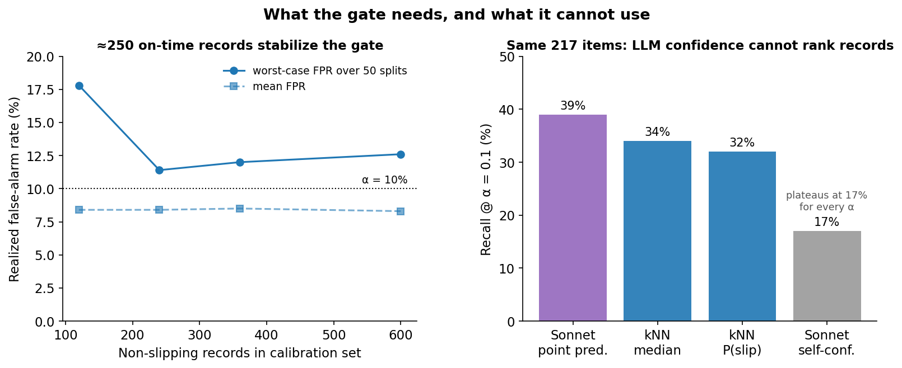

# slipgate

**A label-validated benchmark for work-zone end-date slip, with a false-alarm-guaranteed alert gate.**

Work-zone feeds (WZDx) post an end date for every lane closure, but the posted date is often a permit window rather than the day the work ends. This repository builds a benchmark from 2.5 years of North Carolina WZDx/TIMS data (6.74M feed entities, 11,108 slip-labelled records) and asks two questions: can a language model read a work-zone description and predict slip better than a simple nearest-neighbor over historical records, and can a slip alert be issued with a guaranteed false-alarm rate?

The answers, on this feed, are *no* and *yes*. Two LLMs (Claude Haiku 4.5, Claude Sonnet 4.6), even when handed the nearest historical records, do not outperform a TF-IDF nearest neighbor on 217 paired hard-stratum items (Sonnet: p = 0.56; Haiku: significantly worse). A split-conformal gate calibrated on historical non-slipping records bounds the false-alarm rate by α; on 1,892 records the bound holds at three slip thresholds, recovering about 30% of true slips at α = 0.1 with precision nearly double the base rate. The gate does not depend on the LLM, and cannot: LLM self-reported confidence carries no information.

Along the way we found that labels harvested directly from a polled feed are not usable without cleaning. Batch-process timestamps masquerade as completion times, posted dates fall outside the observation window, records linger after work ends, and projects are re-issued under new IDs. Detection rules for each are included and reproducible.

Total LLM cost for every experiment reported: about US$1.5.



## What slip looks like

The posted window (posted end minus first observation) dominates: a one-day window ends on time 84% of the time, a two-day window 27%. Work type is the second feature. Recurring-schedule language in the description ("nightly", "Mon–Fri") carries almost no information once the window is controlled.



## Do LLMs read more than a nearest neighbor?

On the hard stratum (window > 1 day, non-incident), a retrieval-augmented LLM is given the eight nearest historical records with their realized slips. The small model narrows its intervals without becoming more accurate; the large model tracks the neighbor median at every slip level.



## A conformal alert gate

Recasting the task as "alert if predicted slip > τ days," the threshold is set on calibration records that did not slip so that P(alert | no slip) ≤ α. The realized false-alarm rate matches α out of sample. kNN-derived scores dominate reference-class and raw-window scores at every α; an uncalibrated rule recalls more but with a 44% false-alarm rate.



About 250 historical on-time records are enough to stabilize the gate. The LLM's own confidence cannot serve as a score: it takes only a few discrete values and plateaus at 17% recall.



## Repository layout

```
bench/        label validation, baselines, LLM runner, paired comparison, conformal gate
pipeline/     raw archive → entity table → task_c (provenance of the labels)
data/         task_c_slip_nc_marked.parquet (committed); large files via Zenodo
figures/      README / paper figures (regenerate with make_figures.py)
paper/        manuscript (EN + ZH)
docs/         CONTEXT.md — full project log with every reported number
scripts/      run_all.ps1 — one-shot reproduction
```

All `bench/` scripts read `WZDX_DIR` (default `C:/wzdx`), which must contain `out/` (data) and `cache/` (model responses).

## Reproduce

```
python bench/mark_censored.py                       # label validation
python bench/group_stats.py                         # slip structure
1..10 | % { python bench/runner.py --template knn   --stratify --no-noslip --seed $_ }
1..10 | % { python bench/runner.py --template warm3 --stratify --no-noslip --model claude-sonnet-4-6 --seed $_ }
python bench/compare_runs.py --a "out/pilot_claude-sonnet-4-6_*_seed*.parquet" --b "out/pilot_nomodel_knn30_*_seed*.parquet"
python bench/conformal.py --source pool --tau 7 --alpha 0.1
python make_figures.py                              # regenerate the figures above
```

Paper: [arXiv link TODO]. Data: [Zenodo DOI TODO].

Experimental code, prompt templates and an initial manuscript draft were developed with the assistance of an AI model (Claude). All data processing, experiment execution, design decisions and verification were performed by the authors.
